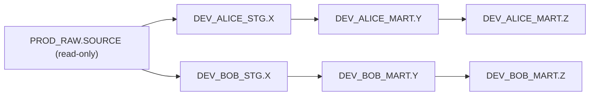
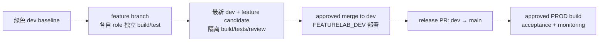
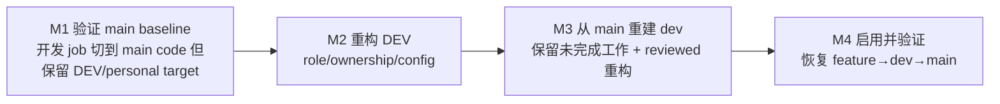

# FeatureLab 开发手册

FeatureLab dbt 项目（`feature-lab` 仓库）的团队开发工作流规范：access control、PR 与 code review、生产正确性验收、DEV 环境迁移步骤。面向人类开发者的协作标准，Kiro 在涉及 `feature-lab` 的工作中按需参考。

> 统一约定：database 为 `FEATURELAB`，warehouse 为 `COMPUTE_WH`；示例开发者为 Alice、Bob、Carter；示例逻辑 DAG 为 `source → x → y → z`（`source` 是示例 RAW model 名，用 `ref('source')` 引用，不是 dbt 的 `source()` 声明）。所有表名、金额、业务规则均为说明机制用的示例，不代表真实生产配置或已完成的部署状态；本文未经专门标注的机制（如 §4.4 现有 CI/CD 控制）以文中记录时点为准，需与仓库当前配置核对。

---

# 1. Access control：保护 PROD 与个人 workspace

### branch / target / role 三者正交，分别决定不同的事  {#branch-target-role}

Git branch 决定本次运行用哪个 code revision；dbt target 决定 database / schema / role 等 profile 配置；Snowflake role 决定当前身份实际可读写的对象。三者不能互相替代推断——checkout main 不会自动获得 PROD 权限，名为 `personal` 的 target 仍需核对实际配置，最终权限边界只由 grants / ownership / role inheritance 决定。

`dev` 是触发整合部署的 Git branch；大写 `DEV` 是 automation-only 的 deployment target，不是团队共用的手动开发 schema。个人开发始终使用各自的 personal target 与 role，即使临时运行 main 上的代码也只写自己的 workspace。保护 PROD 意味着个人身份不能改写 PROD 的 table/view/function/task/project 及其依赖；这条边界由 role 的 grants 构成，不是 branch 名、target 名或操作约定能保证的。

### Writer role 与 ownership 的分配  {#writer-roles}

| 执行主体 | Writer role | 允许写入 |
| --- | --- | --- |
| 各开发者（如 Alice） | `FEATURELAB_PERSONAL_<NAME>` | 已登记的 `DEV_<NAME>` layers |
| dev deployment automation | `FEATURELAB_DEV` | 已登记的 automation-only DEV layers |
| PROD automation / tasks | `FEATURELAB_PROD` | 已登记的 PROD layers 与批准的 ingestion objects |
| DBA | `FEATURELAB_DBA` | managed-access schema ownership 与 grants 管理 |

- DBA 拥有 managed-access schema 的 ownership；runtime role 拥有/管理自己创建的 runtime object。新建 schema 不会自动完成既有 object 的 ownership migration。
- reader role 提供批准的 RAW/PROD/DEV 读权限；个人默认不读取他人 personal table，也不继承 DEV/PROD writer role。
- 核对 effective permission 时须包含 secondary role、role inheritance，以及可能以 owner 权限写入的 routine/automation entry point——只保护最终输出 table 不能阻止依赖对象被绕道修改，需同时检查 function、stage、task、dbt project、Python dependency、external access。
- `DEV_ALICE_*` 等星号仅代表已登记的 layer family，provisioning 需明确列出 schema，不是任意 namespace 的授权规则。

验收标准：Alice 用 `FEATURELAB_PERSONAL_ALICE` 写 `FEATURELAB.PROD_STG.X` 必须被拒绝，也不能通过 hook 改写 PROD function；拒绝发生时应修正 destination，不应扩大个人权限换取 build 通过。

### 每个人 materialize 自己的 DAG 副本  {#personal-dag-copies}



所有 relation 都在 FEATURELAB 库下；schema 名由 `target.schema` 与 custom schema 拼接而成（如 `DEV_BOB` + `stg` → `DEV_BOB_STG`），实际输出仍需按项目 macro/config 核对。Alice 负责 x 的计算、Bob 负责 y 的 aggregation、Carter 负责 z 的业务规则，这只是代码责任划分，不代表三人共用一组可互相覆盖的 table——每人的 x/y/z 各自独立 materialize，互不影响。

Git merge 只更新文件，只有个人 build 才会把采纳的代码 materialize 成个人 table：Alice 重建她的 x 后，Bob 的 x 保持不变，Bob 的 y 不受影响；Alice 的改动合入 dev 并触发 DEV deployment 后，仍不替换 Bob 的 personal table；Bob 需要主动把新代码合入自己的 feature、解决 contract 差异，再重新 build 自己的 x+。x 的接口变化（如单位变化）应保留兼容字段或走 versioned migration，不能靠"听谁的 SQL"来解决。

### Personal build 只 defer source  {#personal-build-defer-source}

```bash
git switch dev && git pull --ff-only origin dev
git switch -c feature/alice-trade-value
uv sync --locked
uv run dbt build --target personal --select x+ \
  --defer --state artifacts/prod --favor-state
```

`--select x+` 选中 x/y/z 及适用 tests，三者都在个人 schema 构建；未 selected 的 source 通过可信 PROD manifest 解析到 canonical input。`--favor-state` 让未 selected 的 source 优先使用 state 中的 relation，避免旧 local source table 悄悄顶替引用——它不改变 selected 节点的 local build，也不授予额外写入权限。缺少有效 manifest 时不应回退为重建 PROD RAW，应取得已验证 artifact 或安排明确批准的隔离 ingestion 实验。

`artifacts/prod/manifest.json` 是项目本地的输入文件，不是 dbt 自动下载的远程位置，获取方式：

1. 在 Snowsight 的 Transformations → dbt Projects 中选一次已确认成功的 `FEATURELAB.PROD.FEATURE_LAB` execution，核对 revision 与执行结果。
2. 从该 execution 的 dbt Output 下载 Download Build Artifacts ZIP，取 `target/manifest.json`。
3. 放入本地 `artifacts/prod/manifest.json`，记录 query ID、revision 与验收证据。

`dbt parse` 也能生成 manifest，但 parse 不能证明其中的 relation 已成功构建，必须用成功 PROD build 的产物。manifest 只描述代码与 relation metadata，不冻结数据，需另外记录 input window/as-of time。当前 GitHub Deploy workflow 未配置 manifest 的 upload/download artifact，这一环节的自动归档待实现。

两条开发路径：普通 transformation work 用 `--select x+` 只 defer source；明确批准的 ingestion experiment 用 `--select source+` 不 defer，会在个人 RAW layer（如 `DEV_ALICE_RAW.SOURCE`）生成数据，不写 PROD_RAW。选择 RAW/seed/Python model/hook 前需审查 external read 与 ingestion side effect。

---

# 2. Code consolidation：PR、AI review 与 DAG 影响分析

### PR 整合代码，不整合数据  {#pr-scope}

PR 整合 SQL、YAML、macro、tests 与配置；个人 table 与 DEV table 不通过 Git merge 晋级到 PROD——晋级的是代码，数据由各环境各自 build 产生。每个 model 应显式 `materialized='table'` 并通过 `ref()` 保留 lineage，不硬编码个人 schema 名。

### AI review 产出可核查发现，不替代人工判断  {#ai-review-scope}

| AI 检查 | 期望输出 | Human reviewer 需确认 |
| --- | --- | --- |
| 重复表达式/CTE | 重复位置和可复用 model/macro | grain、units、filter、null semantics 是否相同 |
| 重复 model | 现有相同职责的 model | 能否扩展已有 contract，是否确需独立 grain |
| DAG impact | ancestors、descendants、共享 macro consumer | 有无 hardcoded relation/hook/外部 consumer 漏项 |
| Contract/tests | 字段或单位变化、缺失的 regression fixture | 业务期望、兼容策略、测试范围是否正确 |

AI 不自行判定业务等价，也不替代 warehouse tests。看起来相似的 SQL 可能用不同口径（单位、filter、含税逻辑），不能仅为减少行数合并；合并复用后仍需独立 expectation 与 downstream reconciliation 验证等价性。

目标保护规则：dev/main 用 PR-only + 独立 approval + required checks；main 禁止 force-push。CODEOWNERS 本身不是 gate，需要 branch rule 强制对应 approval；"PR source 必须是 dev"这类策略需要专门的 required check，普通 branch protection 不会自动强制。

### 按双向影响确定 selector 范围  {#bidirectional-impact}

| Selector | 覆盖范围（对 source→x→y→z） | 限制 |
| --- | --- | --- |
| `x` | 仅 x | 不能证明 downstream 正确 |
| `x+` | x、y、z | 普通 transformation work 的推荐范围 |
| `+y` | source、x、y | 会选中 RAW，不能用于普通 personal build |
| `+y+` | source、x、y、z | 仅用于批准的隔离完整路径 |
| `state:modified+` | 变化节点与 descendants | 大项目初筛，仍要补查 macro/hook/external consumer |

```bash
uv run dbt ls --target personal --select x+ --resource-type model  # 只列出，不构建
```

DAG 展示的是 `ref()` 形成的 lineage，不是全部 external consumer 和 side effect 的清单；多父节点的 test 要确认所有 transformation parent 都已 local build。

### 四类冲突与重新验证  {#conflict-types}

| 冲突类型 | 典型场景 | 应对 |
| --- | --- | --- |
| Git/text | 两个 feature 同时改同一文件 | 合并代码，保留双方有效 fixture |
| Semantic/interface | x 的单位变化，y 仍按旧单位处理 | 明确 contract、兼容迁移、集成测试 |
| Runtime/data | 两人同时各自 build 个人 DAG | schema 隔离，互不读取对方的中间表 |
| Stale validation | 待 merge candidate 已变化，旧测试结果过期 | 基于最新 dev 重建、重新验证 |

dev 前进或 release merge 引入新代码树后，之前的绿色结果不再覆盖新 candidate，必须重新 build/test；conflict resolution 要同时处理 SQL/YAML/macro/fixture，不能靠静默保留重复 key 或删断言换取绿色。

### PR 必须附带的 evidence  {#pr-evidence}

变更目的与 contract（grain/字段/单位/types/null semantics）；受影响的 model、macro/hook caller、external consumer；测试的 base/head revision 或 candidate tree；target、active role、deferred input 与 manifest 来源；实际执行的 checks 及 failures/skips；downstream reconciliation 与 hook/consumer smoke 结果；兼容性/迁移/rollback 影响。required check 失败阻止 merge；post-merge DEV 整合失败阻止 release。

---

# 3. Production correctness：验证层级与各自边界

### 每层检查证明不同的事，互相不能替代  {#verification-layers}

| 检查 | 验证什么 | 不能证明什么 |
| --- | --- | --- |
| pytest | Python helper、workflow、配置 regression | 未执行 warehouse integration 时的 SQL 正确性 |
| `dbt parse` | Jinja/YAML/config/dependency graph 可解析 | SQL、真实数据或 hooks 已成功执行 |
| dbt unit tests | mock input 下的 exact output | live source quality 与完整 DAG integration |
| dbt data tests | 真实 table 的 grain、null、unique、business invariant | 每一种业务错误都会被拦截 |
| Source freshness | 配置好的 freshness SLA | downstream transformation 逻辑正确 |
| Hooks + smoke test | destination、artifact、signature、实际行为 | model test 的替代，或 DAG-wide transaction |

`dbt run` 只 materialize、不跑 test；`dbt test` 只检查现有 relation、不重建 SQL；`dbt build` 按 DAG 跑 selected resource 与适用 test，上游 blocking error 会让 descendant 被 skip——**skipped 不能计为 passing**，required assertion 应用 error severity 而非仅 warn。

### Unit test fixture：覆盖计算逻辑的分支与边界  {#unit-test-fixtures}

单个 `models/*.yml` 可同时放 data tests 和 `unit_tests:`（保持单一 key，避免重复）：

```yaml
unit_tests:
  - name: y_sums_trade_values_by_date
    model: y
    given:
      - input: ref('x')
        rows:
          - {trade_id: 1, trade_date: '2026-10-15', quantity: 2, line_value: 20}
          - {trade_id: 2, trade_date: '2026-10-15', quantity: 10, line_value: 50}
    expect:
      rows:
        - {trade_date: '2026-10-15', total_value: 70, total_quantity: 12, trade_count: 2}
```

fixture 要覆盖容易出错的分支：错误 average 而非 sum、按错误字段 group by、漏掉边界值（如 threshold 判断用 `>= 60` 时须有 59.99 和 60.00 两组数据分别验证 false/true）。unit test 在 Snowflake 执行 SQL，可能需要 parent relation 提供类型 metadata，应在隔离 workspace 准备，不为此在 PROD 建对象。

unit test 只能验证"给定 mock input，输出符合预期"，不能验证真实数据下的集成行为——即使通过，真实 y 若把元改成分，fixture 仍可能照常通过，因此还需要下面的 downstream reconciliation。

### Upstream 诊断：构建前先确认输入质量  {#upstream-diagnostics}

canonical source 只读，用诊断查询记录其当前质量：

```sql
select count(*) as rows_seen, count(distinct trade_id) as distinct_trades,
       count_if(trade_id is null or price is null or quantity is null) as bad_inputs,
       min(trade_date) as first_date, max(trade_date) as latest_date
from FEATURELAB.PROD_RAW.SOURCE;
```

检查 grain、类型、必需字段 null、取值范围、日期覆盖；生产 ingestion 可能在两次 build 之间变化，相同 manifest 不代表相同输入数据。真实 source 应配置 `loaded_at_field` 和 SLA，单独执行 `dbt source freshness`——`dbt build` 不会隐式跑这项检查。

### Downstream reconciliation：验证语义而非只看行数  {#downstream-reconciliation}

Row count 相同不代表数值正确。用 singular test 按 grain 重新计算 expected 值并与实际输出 full outer join 比对：

```sql
{{ config(severity='error') }}
with expected as (
    select trade_date, sum(line_value) as total_value, sum(quantity) as total_quantity, count(*) as trade_count
    from {{ ref('x') }} group by trade_date
)
select coalesce(e.trade_date, y.trade_date) as bad_date
from expected e full outer join {{ ref('y') }} y on e.trade_date = y.trade_date
where e.trade_date is null or y.trade_date is null
   or not equal_null(e.total_value, y.total_value)
   or not equal_null(e.total_quantity, y.total_quantity)
```

期望返回 0 failing rows；`equal_null` 做 null-safe 比较。这类测试能抓住"行数不变但金额算错"的 regression（row count check 会通过，reconciliation 必须失败），但如果 upstream 本身有 bug，reconciliation 可能仍保持一致——需要额外核对一组独立于计算链条的业务期望值作为交叉验证。

### pytest 覆盖 Python 侧与 delivery machinery  {#pytest-scope}

```bash
uv run pytest -q tests/test_prod_cd.py tests/test_prod_schedule.py  # deploy shell、task 依赖顺序
uv run pytest -q  # PR CI 跑完整 suite
```

部分 warehouse 相关测试是 opt-in（如需要 `FEATURE_EXPORT_SQL_TESTS=1` 才跑 SQL integration），默认 skip，执行时需分别报告 executed 和 skipped 的用例，不能把 skip 当 pass。Python logic 用 pytest，SQL transformation 用 dbt fixture，两者职责不重叠，不要为了凑 coverage 在 Python 里重复整套 dbt SQL。

### Hooks 的生命周期与 side effect 检查  {#hooks-side-effects}

| Hook | 用途 | 检查重点 |
| --- | --- | --- |
| `on-run-start` | 记录/校验目的地 | 是否真的 fail-fast，还是只记录不拦截 |
| `pre_hook` | 前置条件或安全检查 | unsafe 时显式失败 |
| `post_hook` | 创建/更新 runtime artifact（如 function） | 存在性、signature、location、行为 |
| `on-run-end` | 汇总 per-node 结果 | 逐项检查 node，不把 hook 成功当全部通过 |

`post_hook` 发生在 model 生命周期内，可能早于后续 graph tests 执行，不能证明所有 downstream test 已通过。关键风险：若 hook 依据某个 `ref()` 的 relation database/schema 推导写入位置（例如动态决定 UDTF 创建在哪个 schema），而该上游 relation 因 `--defer` 解析到了 PROD，hook 可能在"个人 model 是 local"的情况下仍尝试写 PROD——不能假设 schema 位置总是从 `ref().schema` 安全推导；需要显式校验写入 destination 是否在 target allowlist 内，role 拒绝越界写入时应修正 destination 而非给个人提权。

### Release evidence 与故障恢复  {#release-evidence-recovery}

发布前记录：candidate commit、target、active role、deployed version、input window、manifest.json、run_results.json、实际 tests/skips、hook 与 consumer acceptance。

**`dbt build` 不是 DAG-wide transaction**——x 写入成功而 y 失败时，部分 table 已被更新，tests 不会自动回滚这些写入。故障处理顺序：停止后续 scheduled/concurrent writes → 保存 failed revision、query IDs、受影响 relation → 判断 partial state 是否可用、必要时暂停 consumer → 通过 PR revert 代码并重建受影响 descendant，或按批准方案用 Time Travel 从 backup 恢复 → 重新验收后恢复 tasks。重新部署昨天的 SQL 等同于回滚代码，不等同于回滚数据——incremental transformation、source 变化、destructive DDL 都可能需要专门的数据恢复步骤。

---

# 4. 标准化开发流程与 DEV migration

### 正常晋级路径  {#promotion-path}



从绿色 dev 开短期 feature，各自用 personal role build 并检查 upstream/downstream；PR 前 rebase 到最新 dev 并在隔离 candidate workspace 重建；AI review 产出发现，独立 reviewer 确认业务语义后 merge；push dev 触发 `FEATURELAB_DEV` 部署，部署本身串行，个人 build 可并行；对已验证的代码树发 release PR，独立 approval 后晋级 main，PROD build 后执行 data/consumer acceptance。merge queue 或受控合并顺序应验证组合后的 candidate，而不仅是单个 PR 的 diff——post-merge build 能发现整合 regression，但不能追溯阻止已经发生的 bad merge，失败时需立即 block promotion。

### 人与执行身份的职责分工  {#human-vs-runner}

| 动作 | Human owner | Runner / execution identity |
| --- | --- | --- |
| Feature 编辑、personal build | 各开发者 | workstation / 对应 personal role |
| Approved push to dev | maintainer merge | CI pipeline / `FEATURELAB_DEV` |
| PROD deployment | authorized release approver | CI pipeline / `FEATURELAB_PROD` |
| Scheduled PROD build | operator 监控响应 | Snowflake task owner role `FEATURELAB_PROD` |

GitHub approval 不会改变 Snowflake task 的 execution role；Snowflake task owner 需要对应 project/warehouse/task execution 权限单独配置。

### 目标 CI/CD gate（含现状与缺口）  {#cicd-gates-status}

| 阶段 | 目标 gate | 当前状态 |
| --- | --- | --- |
| PR to dev/main | pytest + `dbt parse --target prod`，无 PROD writer credentials | 已有 |
| Approved push to dev | `FEATURELAB_DEV` 部署失败阻止 release | DEV deployment 尚未启用，Deploy job 当前限定 main |
| Release PR | 对同一 code tree 的验证证据，而非重新假设通过 | — |
| PROD schedule | 监控 failure/freshness/deployed revision | 已有 NO_OVERLAP 串行调度 |
| Manifest 归档 | PROD build 产物自动上传供下游 defer 使用 | 未配置，需手动从 Snowsight 下载 |

现有 CI concurrency 按 PR ref 取消过期检查，但不验证多个 PR 组合后的结果；Deploy concurrency 按 branch 避免同一组部署重叠，但不是全库锁，不覆盖独立 manual write。这些机制提供的保护有限，personal-schema isolation、完整 warehouse candidate validation、dev deployment gate 仍需专门配置和验证，不能因为本文列出就视为已落地。

### DEV migration 的四个阶段  {#dev-migration-stages}



贯穿迁移的原则：切 code ref 时保留既有的开发写入边界；晋级的是已验证的代码，不搬运 DEV 环境里的数据表。

**M1（owner：release owner + operator）：** 确认 main 的最新 baseline 已验证（build/test/acceptance 通过），盘点所有 development job（本地脚本、GitHub job、Snowflake project、task、notebook），suspend/drain 后把这些 job 的 code ref 切到该 baseline，同时保留它们原有的 DEV/personal role、target、schedule 配置不变，smoke test 后恢复。Gate：每个 job 跑的是验证过的 main 代码，但仍然只写各自原有的开发 workspace。

**M2（owner：DBA + CI/CD maintainer + developers）：** 在独立 feature branch 准备 DEV 的 schema ownership、role 绑定、RAW routing、conflict policy、hook destination 校验等重构项，期间开发 job 继续用 M1 的 baseline。ownership 变更前 suspend 受影响 task，变更后重新核对 grants。Gate：重构方案在隔离环境验证过 role/target 绑定与 hook side effect 后，才能进入下一阶段。

**M3（owner：maintainer）：** freeze 旧 dev 的 merge，盘点未进入 main 的 open PR 和 commit，为未完成工作保留命名分支，单独保存 M2 的重构 commit；获得 repository owner 批准后，从最新验证过的 main 重建 dev，再通过 PR 把重构应用到新 dev。Gate：新 dev 的历史包含干净的 baseline、reviewed 的重构，以及明确保留的未完成工作，没有用未记录的 reset/force-push 代替这个过程。

**M4（owner：DEV automation + DBA + release reviewer）：** 启用 push-dev 触发的部署，验证写入目的地正确；用一次独立对比证明 isolation——例如一人重建自己的 x 后，另一人的 x/y 内容必须不变；执行 required tests 并确认越界写入被拒绝；确认 schedule 执行的是 approved revision。Gate：各 owner 基于执行证据（而非假设）sign off 整合后的 commit、测试结果、isolation 验证与 rollback 方案；验证方式是故意破坏一个隔离断言，确认它真的会挡住 promotion。DEV 验证失败时 promotion 保持 blocked，不通过放宽隔离换取绿色。

### 持续责任分工与 PR/release checklist  {#ongoing-responsibilities}

| Owner | 持续责任 |
| --- | --- |
| Developers | feature code、unit/data tests、personal build、downstream compatibility |
| Reviewer/maintainer | integration 顺序、contract、branch protection、release evidence |
| DBA | schema ownership、writer mapping、grants、ownership 交接 |
| CI/CD maintainer | 身份隔离、target 绑定、部署串行化、artifact 归档 |
| Production operator | schedule、运行健康度、freshness 告警、故障恢复流程 |

- [ ] candidate 基于最新 dev；冲突解决后已重新跑测试。
- [ ] grain、units、types、null semantics、external consumer 已 review。
- [ ] x/y/z 在个人 schema 本地构建，只有明确批准的 source 被 defer。
- [ ] role/target/schema 绑定正确，PROD 与他人 personal workspace 不可改写。
- [ ] required tests 实际执行，failures/skips 分别记录，source freshness 独立确认。
- [ ] boundary fixture 与 downstream reconciliation 通过，并核对独立于计算链条的业务期望。
- [ ] hooks/functions/consumer smoke check 通过。
- [ ] revision、inputs、deployed version、manifest、run_results、acceptance evidence 已保存。
- [ ] operator、监控、rollback/restore 方案已明确。
